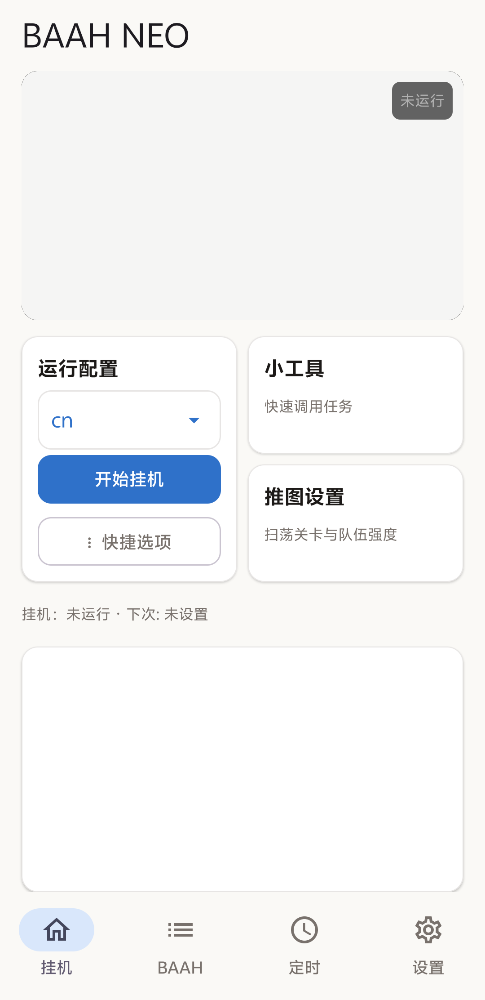

<p align="center">
  
</p>

# BAAH NEO

[简体中文](README.md) · English

BAAH NEO is an Android assistant for Blue Archive dailies, built on MaaFramework. It runs upstream BAAH tasks on a separate virtual display and provides configuration management, scheduling, live preview, logs, and notifications.

BAAH NEO uses upstream BAAH's tasks and image recognition. You can install updates over an existing copy of BAAH NEO.

**Version 0.1.0** (`com.baah.neo`) · [GitHub Releases](https://github.com/dnuxysn/BAAH-NEO/releases)

[Features](#features) · [Screenshot](#screenshot) · [Getting started](#getting-started) · [Scheduling](#scheduling) · [Backups and updates](#backups-and-updates) · [Reporting issues](#reporting-issues) · [Development](#development) · [Credits and license](#credits-and-license)

## Features

- Run upstream BAAH tasks such as café visits, lessons, reward collection, and stage sweeps.
- Manage configurations for different game servers and customize task order, teams, and flows.
- Run the game on a separate virtual display with live preview and full-screen interaction.
- Schedule runs at fixed times or regular intervals, with a foreground or background mode for each rule.
- View and export logs and configure progress and result notifications.
- Check for upstream BAAH updates and export or restore complete BAAH NEO backups.

Available tasks and options depend on the installed version of upstream BAAH and the selected server.

## Screenshot



## Getting started

### Requirements

- An `arm64-v8a` device running Android 9 or later.
- Blue Archive installed for the server you want to use.
- Shizuku running and authorized for BAAH NEO.
- Internet access and enough storage to set up the Python environment and download upstream BAAH and its dependencies on first launch.

This release provides the source code. A prebuilt APK will be available after the distribution materials for the bundled runtime are ready.

### First run

1. Install the BAAH NEO APK.
2. Start Shizuku by following the instructions in the Shizuku app.
3. Open BAAH NEO and tap **Initialize**. Wait for the Python environment, upstream BAAH, and its dependencies to be ready, then grant Shizuku access when prompted.
4. Open **BAAH**, choose or create a configuration for your game server, and check the selected tasks and teams.
5. Return to **Run**, select the configuration, and tap **Start**. You can follow progress and view the game from this tab.

When trying a new configuration, you can start with a short task such as signing in before enabling tasks that spend stamina, materials, or attempts.

### Configurations and individual tasks

Open **BAAH → Manage configurations** to manage multiple configurations. Tap a configuration to select it, then tap it again to rename it. Existing schedules follow the new name. Use **Run → Tools** to call an individual task.

Before starting a run, verify the game server, task order, and resource spending options. Stop any active run before editing its configuration or restoring a backup.

## Scheduling

Open **Schedule** and add a rule. Select a configuration, then choose fixed times or a run interval. After saving, check that the rule is enabled and that the next run time looks right.

The **Run mode** switch is under **Advanced options**.

| Switch | Mode | Behavior |
| --- | --- | --- |
| On | Background | Runs the game on the virtual display while keeping your current screen visible. |
| Off | Foreground | Brings BAAH NEO to the foreground at the scheduled time and keeps the screen awake while it runs. |

The game runs on the virtual display in either mode. Foreground mode needs permission to open the BAAH NEO screen. If the lock screen prevents it from opening, the run records a startup failure and prompts you to unlock the device.

Exact alarms, auto-start, and background execution permissions can affect scheduling. Test your setup with a short task and check the run history.

## Backups and updates

### Backups

- Use **Settings → Export configuration** to save a complete backup.
- Use **Settings → Import configuration** to restore a complete BAAH NEO backup.
- Use **Manage configurations** to import or export an individual configuration.

Restoring a backup replaces the corresponding data. Save a copy of your current configuration before restoring.

### Updates

- **BAAH NEO** updates through a newer APK with the same package name and signing certificate. You can select a local APK in Settings to check its identity and version.
- **Upstream BAAH** updates independently through **Settings → Check BAAH updates**.

Stop active tasks and export a backup before updating.

## Reporting issues

Include the BAAH NEO and upstream BAAH versions, your phone model and Android version, the game server, and the affected tasks. Say whether the run started manually or on a schedule and whether you used foreground or background mode. Provide the time, steps to reproduce, and what you expected to happen.

You can view and export launcher and BAAH task logs from **Settings**. For performance issues, include the task list and any per-task timings you have.

## Development

BAAH NEO uses Project Interface V2 to describe full workflows and individual tasks. MaaFramework Tasker starts the tasks and reports whether they completed, failed, or stopped. Upstream BAAH supplies the Python task logic and image recognition. The Android host provides Shizuku integration, the virtual display, screenshots and input, scheduling, notifications, and backups.

The PI V2 parser reuses code from a pinned version of MaaFwApp. The bundled MaaFramework version is recorded in the framework lockfile. [Parser source notes](third_party/MaaFwApp-pi/SOURCE.md) · [Framework lockfile](framework.lock.json)

### Local build

Use JDK 21, Python, and Android SDK 36 with SDK extension 19. Set the Android SDK location in `local.properties`. The APK build also requires the Python root filesystem at `app/src/main/assets/baah-rootfs.tar.xz` and the four proot shared libraries. [Runtime asset provenance](third_party/baah-adapter/README.md)

```powershell
python scripts/fetch_framework.py
python scripts/create_neo_signing.py
./gradlew.bat :app:assembleGithubDebug :app:testGithubDebugUnitTest :app:lintGithubDebug --console=plain
python scripts/test_adapter_protocol.py
```

Generate the signing configuration once for your local builds. Reuse the same signing key for updates to your installations. Keep `neo-signing.properties` and the `signing/` directory local.

Build a distribution APK with `./gradlew.bat :app:assembleGithubRelease`. The output is in `app/build/outputs/apk/github/release/`.

### Contributing

Describe the problem, the behavior after the change, and how you tested it. Include results from a real device for changes to Android lifecycle, the virtual display, input, or scheduling. For task integrations, check the upstream BAAH version and server differences. Keep attribution and license notices for reused code.

## Credits and license

BAAH NEO is an unofficial community project. Most new code and integration changes were written with OpenAI Codex at the maintainer's direction. The app icon was generated with ChatGPT and selected by the maintainer.

BAAH NEO includes code derived from AGPL-3.0 projects. See the project license and third-party notices for the source and license of reused components. [Project license](LICENSE)

| Project | Role | License and source |
| --- | --- | --- |
| BAAH-AOS / MaaFwApp | UI, configuration editor, and adapter code | [Provenance and AGPL-3.0 license](third_party/baah-adapter/README.md) |
| MaaFwApp PI components | Project Interface V2 parser | [Provenance](third_party/MaaFwApp-pi/SOURCE.md) · [License](third_party/MaaFwApp-pi/LICENSE) |
| MaaFramework | Automation controller and Tasker | LGPL-3.0 · [License](third_party/MaaFramework/LICENSE.md) |
| Blue Archive Aris Helper | Upstream Python game tasks | MIT |
| Shizuku | Android system service access | See its upstream license |
