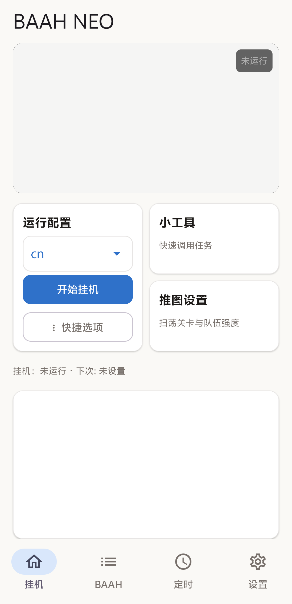

<p align="center">
  
</p>

# BAAH NEO

简体中文 · [English](README.en.md)

基于 MaaFramework 的碧蓝档案／蔚蓝档案 Android 日常助手。在手机的独立虚拟屏中运行上游 BAAH 任务，提供配置管理、定时执行、画面预览、日志和通知。

BAAH NEO 使用上游 BAAH 的任务与识图逻辑。支持覆盖升级。

当前版本为 **0.1.0**（`com.baah.neo`）。[查看 GitHub Releases](https://github.com/dnuxysn/BAAH-NEO/releases)。本次发布源码，APK 将在内置运行环境的分发材料备齐后提供。

[功能](#功能) · [实机截图](#实机截图) · [安装与使用](#安装与使用) · [定时任务](#定时任务) · [备份与更新](#备份与更新) · [问题反馈](#问题反馈) · [开发](#开发) · [开发与图标](#开发与图标) · [来源与许可](#来源与许可)

## 功能

- 按配置执行咖啡馆、课程表、奖励领取、关卡扫荡等上游 BAAH 任务。
- 管理多套游戏与服务器配置，调整任务顺序、队伍和自定义流程。
- 在独立虚拟屏中运行游戏，查看实时画面并进行全屏交互。
- 按固定时刻或间隔执行任务，为每条定时规则选择前台或后台模式。
- 查看与导出任务日志、配置运行进度和结果通知。
- 检查上游 BAAH 更新，导出与恢复 NEO 完整备份。

具体任务与选项以已安装的上游 BAAH 版本和所选服务器配置为准。

## 实机截图



## 安装与使用

### 设备要求

- Android 9 或更新版本，`arm64-v8a` 设备。
- 已安装目标游戏。
- 已启动 Shizuku，并授予 BAAH NEO 控制权限。
- 首次初始化时能够联网下载上游 BAAH 和 Python 依赖，并有足够空间解压运行环境。

配置改名已在 vivo V2227A（Android 14）实机验证。

### 首次运行

1. 安装 BAAH NEO APK。
2. 按 Shizuku 应用中的指引启动服务。
3. 打开 NEO，点击「开始初始化」，等待 Python 环境、上游 BAAH 和依赖准备完成，再按提示授予 Shizuku 控制权限。
4. 进入「BAAH」，选择或新建与游戏、服务器对应的配置，检查任务和队伍后保存。
5. 回到「挂机」，选择运行配置，点击「开始挂机」。在该页查看画面与进度。

首次验证配置时，可先运行登录等短流程，再开启需要消耗体力、材料或挑战次数的任务。

### 配置与单项任务

「BAAH」页面用于编辑任务选项和管理多套配置。在「编辑配置」里点选配置，再点同一项即可改名。已有定时会继续使用改名后的配置。「挂机」页面的小工具可调用指定任务。

运行前确认游戏版本、服务器、任务顺序和资源消耗选项。配置编辑与完整备份操作应在任务停止后进行。

## 定时任务

进入「定时」新建规则，选择运行配置，再设置固定时刻或执行间隔。保存后检查规则是否启用，以及页面显示的下一次触发时间。

「高级选项」中的运行模式采用以下开关约定。

| 开关 | 模式 | 行为 |
| --- | --- | --- |
| 开启 | 后台模式 | 保留手机当前界面，在虚拟屏中执行任务 |
| 关闭 | 前台模式 | 到点将 NEO 界面带到前台，任务运行期间保持亮屏 |

两种模式的游戏都在虚拟屏中运行。前台模式需要系统允许打开 NEO 界面，锁屏拦截时会记录启动失败并提示解锁。

精确闹钟、应用自启动和后台运行权限会影响定时投递。完成设置后，可先用一条短任务规则验证实际触发结果，并在触发历史中检查是否完成。

## 备份与更新

### 备份

- 「设置 → 导出配置」生成 NEO 的完整备份。
- 「设置 → 导入配置」恢复 BAAH NEO 的完整备份。
- 单份运行配置可在配置管理界面导入和导出。

完整备份可能包含已填写的账号或通知服务凭证，请妥善保管。恢复操作会替换对应数据，建议先导出当前备份。

### 更新

NEO 应用与上游 BAAH 分别更新。

- **NEO 应用**通过安装同包名、同签名的新 APK 覆盖升级。在设置中可选择本地 APK，核对应用身份与版本。
- **上游 BAAH**通过「设置 → 检查 BAAH 更新」检查和安装上游 Release。

更新前先停止任务并导出备份。覆盖升级沿用 NEO 专用签名，应用设置和运行配置保存在应用私有目录中。

## 问题反馈

反馈时请附上以下信息。

- NEO 版本、上游 BAAH 版本、手机型号和 Android 版本。
- 游戏服务器、涉及的任务、手动或定时启动方式，以及前台或后台模式。
- 问题发生的时间、复现步骤，以及预期行为和实际行为。
- 对应时段的启动器日志与 BAAH 任务日志，必要时附截图。

日志可在「设置」中查看和导出。

报告运行缓慢时，请同时提供任务清单和各任务耗时。整轮时间会受任务数量、游戏等待、战斗过程及手机调度影响。

## 开发

### 运行架构

NEO 使用 Project Interface V2 描述完整工作流和单项任务入口，由 MaaFramework Tasker 调度并接收完成、失败和停止结果。

上游 BAAH Python 负责识图、任务顺序与游戏业务逻辑。NEO 提供 Android 宿主、Shizuku 服务、虚拟屏、截图与输入、定时、通知和备份。Python 直接读取虚拟屏截图服务输出的 BGR 帧。

PI V2 解析器复用固定版本的 MaaFwApp 开源组件，来源记录见 [MaaFwApp PI 组件说明](third_party/MaaFwApp-pi/SOURCE.md)。随附 MaaFramework 版本锁定在 [framework.lock.json](framework.lock.json)。

### 本地构建

需要 JDK 21、Python 和 Android SDK 36，SDK extension 为 19。

在项目根目录准备 `local.properties` 中的 Android SDK 路径，然后执行。

```powershell
python scripts/fetch_framework.py
python scripts/create_neo_signing.py
./gradlew.bat :app:assembleGithubDebug :app:testGithubDebugUnitTest :app:lintGithubDebug --console=plain
python scripts/test_adapter_protocol.py
```

构建用于分发的 APK 时使用 `./gradlew.bat :app:assembleGithubRelease`，输出位于 `app/build/outputs/apk/github/release/`。

签名生成脚本仅在首次建立开发环境时运行。后续构建沿用同一份 `neo-signing.properties` 和 `signing/`，以保持覆盖升级能力。签名文件与凭证仅保存在本地。

构建 APK 还需自行提供 Python 根文件系统资产 `app/src/main/assets/baah-rootfs.tar.xz` 和四个 proot 共享库。资产来源见 [BAAH 适配来源记录](third_party/baah-adapter/README.md)。这些二进制运行环境资产未包含在源码仓库中。

### 数据位置

以下路径均相对于应用私有的 `files/` 目录。

| 内容 | 路径 |
| --- | --- |
| 上游 BAAH | `baah/` |
| 运行配置 | `baah/BAAH_CONFIGS/` |
| NEO 设置与定时 | `neo-settings.json` |
| BAAH 用户数据 | `baah-user/` |

NEO 使用本地端口 `23320`、`23420` 和 `8020`。[bridge_probe.py](scripts/bridge_probe.py) 可检查控制器截图与输入。

### 参与开发

提交修改时，说明具体问题、修改后的行为和验证方式。涉及 Android 生命周期、虚拟屏、输入或定时的改动，应同时提供实机验证结果。

新增任务适配时，核对上游 BAAH 版本与服务器差异。涉及复用代码时，保留原始署名、许可证和来源记录。

## 开发与图标

NEO 的新增代码与适配修改主要由 OpenAI Codex 根据维护者需求编写，开发过程中进行了构建检查与手机实测。

应用图标由 ChatGPT 生成，由维护者选定并提供。

## 来源与许可

BAAH NEO 包含 AGPL-3.0 派生部分，项目许可证见 [LICENSE](LICENSE)。复用组件的原始署名、许可和来源记录随项目保留。

| 项目 | 用途 | 许可与来源 |
| --- | --- | --- |
| BAAH-AOS / MaaFwApp | 界面、配置编辑和适配组件 | [适配来源与 AGPL-3.0 许可](third_party/baah-adapter/README.md) |
| MaaFwApp PI 组件 | Project Interface V2 解析 | [来源说明](third_party/MaaFwApp-pi/SOURCE.md) · [许可证](third_party/MaaFwApp-pi/LICENSE) |
| MaaFramework | 自动化控制器与 Tasker | LGPL-3.0 · [随附许可证](third_party/MaaFramework/LICENSE.md) |
| Blue Archive Aris Helper | 上游 Python 游戏任务 | MIT |
| Shizuku | Android 系统服务访问 | 见项目依赖及其上游许可 |

本项目为社区开发的非官方工具。